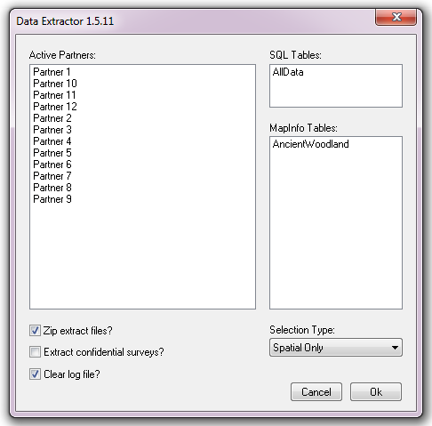

.. index::
	single: Running the tool

****************
Running the tool
****************

For the routine workflow and a worked extraction, see
:doc:`../quickstart/quickstart`.

.. index::
    single: Extraction; prerequisites
    single: Workspace; preparation

Before you run
==============

As discussed in the :doc:`Setting up the tool <../setup/setup>` section, the DataExtractor tool is operated from a MapInfo workspace within which the GIS layers required to run the tool are already loaded. It also relies on an SQL database containing the boundaries of the relevant partners, the SQL tables containing any data that may be extracted, and a configuration document for setting up the tool. Therefore, before running the tool, ensure the following conditions are met:

- A MapInfo document has been created which contains both the partner boundary GIS layer and any MapInfo GIS layers that may be included in the extraction. 
- The SQL Server connection is available. For SQL extractions, the database contains the required data, auxiliary tables and stored procedures, and an up-to-date partner boundary table (or the upload option is configured).
- The file DSN for the SQL database has been created.
- The XML configuration document has been set up correctly, both for general settings and for each individual layer that will be queried. It is also named correctly and in the same directory as the tool MapBasic application (.MBX).
- The DataExtractor tool has been installed and is loaded in MapInfo using the MapInfo Tool Manager.

.. seealso::
	Please refer to the :doc:`setup <../setup/setup>` section for further information about any of these requirements.

.. index::
	single: Opening the form
    single: Profiles; choosing a profile

Opening the form
================

Launch DataExtractor using the ribbon button or classic Tools menu described
in :ref:`figExtractorLaunch`.

If several profile XML files are present beside the MBX, first choose the required profile. If only one is present, it is loaded automatically. The main configuration file selects the default profile.

If there are any structural issues with the XML document, the tool will display a message that it has encountered an error, and not load any further. If any of the map layers that are listed in the configuration document are not present in the active workspace a warning will be shown. The layers that are missing will not be loaded into the form and so cannot be included in the extracts.

Provided that the XML document is otherwise correct, the form will display (:numref:`figExtractorForm`).

.. index::
    pair: Outputs; overwriting
    single: Outputs; files from previous runs
    single: Output folders; avoiding conflicts

.. _output_overwriting:

Protecting existing outputs
===========================

.. caution::
    Reusing the same partner folders and output names can replace files from
    an earlier extraction. Before rerunning, preserve any results you need to
    keep or use a separate output destination. Names depend on the profile and
    partner abbreviation; date variables do not necessarily make every run
    unique. Avoid concurrent runs writing the same final files.

    A skipped output does not clear older files with that name. Check the
    current log to establish which outputs this run produced. A fresh
    ``WorkingDir`` subfolder keeps working runs separate, but does not protect
    existing files at the final destination. Before extraction or partner
    upload, the tool checks requested output destinations, including names
    shortened to 31 characters, and stops if they conflict; see
    :ref:`output_name_limits`. A later run can still replace the same output.
    ``Clear log file?`` controls the log only; it does not control output
    replacement.

.. index::
	single: Using the form
    single: Partners; selecting
    single: SQL outputs; selecting
    single: MapInfo layers; selecting
    single: Partners; displaying notes
    single: Extraction; options

Using the form
==============

The form can process multiple partners and output definitions during a single execution. Select the partners for which you wish to run the extraction, and the SQL and / or MapInfo tables that you would like to include, what type of SQL extraction you would like to carry out (spatial, survey tags, or both), make sure all other options are correct then press **OK**.

.. _figExtractorForm:

    Selecting partners, output definitions and extraction options

The :guilabel:`SQL Tables` list contains output definitions from SQLTables;
the source SQL table is specified separately for each partner in SQLTableColumn.
The :guilabel:`MapInfo Tables` list contains configured layers that are open in
MapInfo. Selecting an output in the form does not override the partner's
SQLFilesColumn or MapFilesColumn: it must be requested in both places.
Double-click a partner to display its notes.

.. index::
    pair: ZIP output; selecting
    pair: Exclusion clause; applying
    pair: Logs; clearing
    pair: Centroids; polygon selection
    pair: Partner boundaries; uploading to SQL Server

Check the available options before starting:

* :guilabel:`Zip extract files?` packages each partner's outputs separately.
* :guilabel:`Apply exclusion clause?` adds the configured exclusion condition
  to SQL outputs only.
* :guilabel:`Clear log file?` archives the existing main log before starting
  a new one. Leave it unchecked to append this run to the existing log.
* :guilabel:`Select polygons by centroids?` passes the centroid option to
  SQL Server selection. It does not change the MapInfo selection behaviour
  described below.
* :guilabel:`Upload partner table to server?` uploads the open partner table
  using EasyLoader when SQL outputs have been selected. Otherwise ensure
  the SQL Server copy is already up to date.

.. index::
    single: Selection Type
    pair: Spatial selection; SQL outputs
    pair: Survey tags; SQL selection

Some options may be hidden by the profile. Selection Type applies to SQL
outputs: the combined option includes spatial matches and survey-tag matches.

.. index::
    single: MapInfo layers; spatial selection
    pair: Partner boundaries; missing geometry
    single: Non-spatial partner rows
    single: Intersection; whole features
    single: Clipping; MapInfo outputs

.. _mapinfo_selection:

MapInfo selection behaviour
---------------------------

In the ordinary spatial path, the tool selects source features intersecting
the current partner's boundary and applies the output's ``WhereClause`` and
``OrderClause``. When geometry is included in the output, selected MapInfo
features retain their whole geometry: intersection selects features and does
not clip them to the partner boundary. SQL output geometry depends on the
installed stored procedures; this MapInfo description does not define their
behaviour.

The tool checks geometry only for the selected partner in ``PartnerTable``.
If any of that partner's rows contain geometry, their boundaries are used;
matching rows without geometry are ignored. Other partners, including inactive
or unselected rows, do not change this selection.

A partner whose rows all lack geometry uses attribute-only selection. Its
``WhereClause`` filters the source rows and ``OrderClause`` still applies;
a blank condition selects every source row. The log identifies this as a
non-spatial partner selection. Prepare the selected partner's boundary or
attribute condition for the extraction intended. If the partner has been
removed since the form opened, the output is skipped and the log reports it.

Starting and finishing an extraction
------------------------------------

.. caution::
	The tool can run for a considerable amount of time dependent on the number of records that are being selected.

.. index::
    single: Progress window
    single: Cancelling extraction
    single: Extraction; cancellation

A progress window shows the extraction progress. Use **Cancel** to interrupt
processing; see :ref:`working_outputs` for handling unfinished local outputs.

When the extract process finishes it asks the user whether to close the form or keep it open for subsequent use.

.. index::
    single: Logs; reviewing
    single: Extraction; completion

Once the user makes a choice the log file is shown. This should be checked thoroughly to ensure that all expected extracts have been generated, the format of the extract files is correct, and that the number of records included in each extract file is as expected.

The following illustrative excerpt shows the kind of messages to check.
Timestamps and intervening messages are omitted, and the name and count are
examples rather than the results of a recorded test run:

.. code-block:: text

    Process started!
    Processing partner 'Example Partner (P1)' ...
    25 records selected.
    Exporting as a CSV file ...
    Export complete.
    Processing for partner complete.
    Process completed!

For ZIP output, also check for successful archive verification. With
WorkingDir enabled, check the partner transfer and final diagnostics messages.
Review the complete log for errors and skipped outputs, even when the final
message says processing completed.

You can now repeat the extract process for different partners and/or files as required.

.. index::
	single: Extraction results
    single: Outputs; checking
    pair: Outputs; skipped extracts
    single: Record counts; checking results

Extract results
===============

Completed outputs are delivered to the :ref:`DefaultPath <defaultpath>` folder specified in the profile. If WorkingDir is configured, they are created locally first and transferred after each partner is completed. Each partner has its own sub-folder where the extract files for that partner are stored in the formats specified in the partner GIS layer.

The main log is saved in :ref:`LogFilePath <logfilepath>` as ``DataExtractor_<userid>.log``. Check it even after a completion message: individual outputs can be skipped because no records match, the partner does not request them, or the record count exceeds RecMax.

.. index::
    single: Output formats; quick reference
    single: OutputType; override precedence
    single: CSV; format reference
    single: TXT; format reference
    single: TAB files; format reference
    single: Shapefiles; format reference

.. _output_formats:

Output format reference
=======================

Each partner has a GIS format and an optional additional text-export format.
The example profile calls the columns GISformat and Exportformat; their actual
names are configured by FormatColumn and ExportColumn. Both settings apply
to each requested output, subject to any OutputType override below.

.. list-table:: Partner format values
    :header-rows: 1
    :widths: 17 25 58

    * - Value
      - Partner column
      - Output requested
    * - TAB
      - GISformat
      - MapInfo TAB output, including its companion files.
    * - SHP
      - GISformat
      - Shapefile output, including its companion files.
    * - Both
      - GISformat
      - TAB and SHP outputs.
    * - Blank
      - GISformat
      - No GIS output unless the definition supplies a GIS OutputType.
    * - CSV
      - Exportformat
      - A comma-delimited .csv file with column headings.
    * - TXT
      - Exportformat
      - A comma-delimited .txt file without column headings.
    * - Blank
      - Exportformat
      - No additional text export unless a MapTables definition requests it.

Use CSV, TXT or a blank export value, rather than Y/N. Both text formats use
Windows Latin-1 encoding. For example, GISformat ``Both`` and Exportformat
``CSV`` request TAB, SHP and CSV for each output; blank GISformat and ``CSV``
request text output only. Keep the complete companion-file sets when copying
or delivering GIS outputs.

OutputType in an individual SQLTables or MapTables definition can override
the partner's choices:

.. list-table:: OutputType overrides
    :header-rows: 1
    :widths: 18 41 41

    * - OutputType
      - SQLTables definition
      - MapTables definition
    * - Blank
      - Use the partner's GIS and text formats.
      - Use the partner's GIS and text formats.
    * - TAB, SHP or Both
      - Override the GIS format; keep the partner's text format.
      - Override the GIS format; keep the partner's text format.
    * - None
      - Suppress GIS output; keep any partner-requested text export.
      - Suppress GIS output; keep any partner-requested text export.
    * - CSV or TXT
      - Use the partner's ExportColumn for text output instead; these are
        not supported text-format overrides for SQL definitions.
      - Suppress GIS output and use this text format instead of the
        partner's export format.

For example, OutputType ``None`` with a partner-requested CSV export produces
CSV only. These choices do not override the partner/form output-list checks,
record filters or record limits. Blank file lists request no outputs, and
empty or oversized extracts can be skipped.

.. index::
    single: WorkingDir; operation
    pair: Output folders; local staging
    pair: Outputs; recovery
    single: Robocopy
    single: File transfers; retries and failures
    single: Outputs; overwriting existing files
    single: Cancellation; unfinished outputs

.. _working_outputs:

Local working folder and recovery
=================================

With WorkingDir configured, each run creates a fresh subfolder there. Partner
and format subfolders use the same names as at the final destination. Exports,
CSV/TXT post-processing and optional ZIP creation finish before the tool closes
the partner's output tables and transfers its folder to DefaultPath. Completed
partners are transferred during the run, rather than waiting for every partner.

Transfers use Windows Robocopy with three retries and a two-second delay.
Existing files with matching names are replaced; unrelated destination files
are retained. A transfer failure stops further processing and leaves remaining
local files at the location recorded in the log. Transfers can partially
succeed, so check both locations before recovering an output.

Cancellation retains unfinished local outputs. A later run uses a fresh working
folder and does not automatically resume or include retained files. Check the
log and decide whether to recover those files or rerun the affected partner.
Empty working folders are removed after processing.

When WorkingDir is missing or blank, outputs are created directly in DefaultPath.
Choose distinct partner folders and avoid simultaneous runs writing to the same
destination.

.. index::
    single: ZIP output
    pair: ZIP output; verification
    single: ZIP output; failure recovery
    single: tar.exe
    single: fc.exe
    single: Disk space; ZIP verification
    single: Links and junctions

.. _zip_outputs:

ZIP output
==========

ZIP creation uses the Windows native ``tar.exe`` and ``fc.exe`` tools with normal
user permissions. Their availability is checked before a ZIP-enabled run starts.
They must be installed and permitted by your organisation. There is no additional
ZIP script to deploy with version |release|; the legacy ``zip.vbs`` is not called by this
version. Configured export macros still use Windows Script Host.

The tool creates a candidate archive in a separate temporary folder, checks it,
extracts it and compares the restored files byte for byte with the originals.
Only a verified archive replaces an existing ZIP. Source files are then removed.
Allow disk space for the original outputs, candidate ZIP and extracted copy.
Links and junctions within a partner output folder are not supported.

If verification or archive replacement fails, the previous ZIP and original
outputs are retained. A source-cleanup failure can leave a verified new ZIP
alongside remaining originals. Check the recovery locations in the log and
confirm the archive's contents before deleting retained files. With staging
enabled, the completed ZIP is transferred with the partner's folder.

.. index::
    single: Logs
    pair: Logs; temporary journal
    single: Logs; publication failures
    single: Logs; supporting diagnostics
    single: LogFilePath; run diagnostics
    single: EasyLoader; diagnostic log
    single: Universal Translator; diagnostic files
    single: Export macros; diagnostic log

.. _run_logs:

Run logs and diagnostics
========================

During processing, messages are buffered in memory and written to a temporary
run journal. With staging enabled, the journal, Universal Translator files,
EasyLoader log and export-macro log use the working run folder. Without staging,
the journal uses LogFilePath. The journal is named
``DataExtractor_<userid>_tmp_<run-token>.log``. The working folder location is
recorded at the start of a staged run.

At completion, cancellation or a handled processing error, the tool moves
supporting log and translator files from the top level of the working folder
to LogFilePath and appends the buffered messages to the main log. The main log is then
opened for review. It is updated at the end of the run, so use the temporary
journal to inspect progress while processing.

If the main log cannot be written, the messages remain in memory and the
temporary journal is retained. Restore access to LogFilePath and retry before
starting another run; pending messages must be published first. Preserve the
journal if you need to close MapInfo, as the memory buffer will not survive
closing the application. A failed diagnostics transfer leaves files in the
working folder for recovery. The log records the relevant paths.
