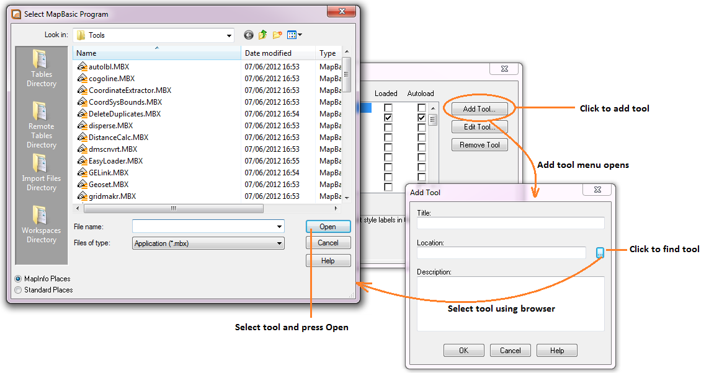
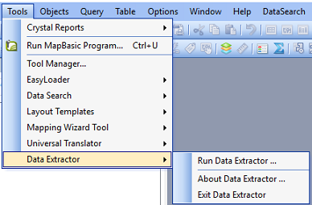

*******************
Setting up the tool
*******************

This chapter describes DataExtractor for MapInfo version |release|. Install the
application and prepare its configuration and data before making it available
to users.

.. index::
    single: Administrators; setup and upgrades
    pair: Upgrading; profile backups
    single: Profiles; migration from older versions
    single: Installation; verification

.. _administrator_setup:

Administrator setup and upgrades
================================

Complete these checks before making a new installation or updated profile
available to routine users. The detailed settings and installation instructions
follow in this chapter.

1. **Back up the existing installation.** Keep copies of the working MBX,
   ``DataExtractor.xml``, all profile XML files and any custom export scripts.
   Record which MapInfo version and architecture they were used with so the
   previous setup can be restored if necessary.
#. **Deploy a consistent set of files.** Install the compiled application for
   the intended MapInfo version, its supporting icons, main XML file and profiles
   together. Confirm that configured Universal Translator, EasyLoader and export
   scripts are available at their configured paths. Source edits alone do not
   update an MBX. ZIP creation in version |release| uses Windows ``tar.exe`` and ``fc.exe``;
   local staging uses Robocopy.
#. **Validate the profile and its data.** Check the XML structure, paths, source
   table names, column names and output definition names. Each partner needs
   the appropriate SQL source and separate SQL/map output lists. Ensure the
   partner boundary table and required MapInfo layers open in the prepared
   workspace. Check that selected partners have the intended boundaries or
   attribute-only conditions; see :ref:`mapinfo_selection`. Check the file DSN
   connection and, for SQL extracts, the stored
   procedures and permissions described under :ref:`sql_database_setup`.
   Maintain the SQL Server partner boundaries or configure and test their
   upload. Review the migration notes below when using older profiles.
#. **Check folders and access.** Verify that users can create, replace and
   remove their outputs and write logs in the configured folders. If WorkingDir
   is used, check local free space, final-destination access and transfer access
   for the same Windows account that will run MapInfo. Use distinct partner
   subfolders and avoid simultaneous runs writing to the same destination.
#. **Test a representative extraction.** Use a test destination and partners
   covering the SQL and MapInfo outputs that will be used. Check record counts,
   selection type, exclusion and centroid options, formats and complete GIS file
   sets. Test any export macros and verify the contents of ZIP outputs. If local
   staging is used, confirm completed outputs reach DefaultPath and the main
   log and diagnostics reach LogFilePath. Review the entire log for errors and
   skipped outputs before making the setup available to users.

Older profiles may require the following changes. Check the current
:ref:`example_xml` rather than copying settings from another tool.

.. list-table:: Migrating older MapInfo profiles
    :header-rows: 1
    :widths: 32 68

    * - Older setting or value
      - Current configuration
    * - ``FilesColumn``
      - Use SQLFilesColumn and MapFilesColumn for separate partner output
        lists, and SQLTableColumn for the partner's SQL source table.
    * - ``ConfidentialClause`` and ``DefaultConfidential``
      - Use ExclusionClause and DefaultExclusion. Check the condition and
        default carefully: the current checkbox applies the exclusion clause.
    * - SQL output ``TableName``
      - Use OutputName for the output filename. MapTables/TableName still
        identifies the source MapInfo layer; it is not renamed.
    * - ``Clause`` or ``Clauses`` for an output filter
      - Use WhereClause for the condition and OrderClause for complete
        ordering/grouping clauses. Symbology rules still use Clause.
    * - ``Y``/``N`` text-export flags
      - Use CSV, TXT or a blank value in the partner's export-format column.
    * - Symbology ``Type`` and ``Style``
      - Use the current point Symbol or region Pen/Brush structure shown
        in the configuration guidance.

.. index::
	single: Installing the tool
    pair: MapInfo; installation
    single: MBX files
    single: Tool Manager
    single: Automatic loading
    single: AutoLoad

Installing the tool
===================

Use an application compiled from the source for version |release|;
editing the source does not update an existing MBX. Select the application
appropriate for your MapInfo version and 32-bit or 64-bit installation.

1. Keep the MBX, its supporting icon files, ``DataExtractor.xml`` and profile
   XML files together in the tool folder. Configure the profiles as described
   later in this chapter before running the tool.
#. Open MapInfo's tool-management window. In the classic interface this is
   :kbd:`Tools --> Tool Manager...`; the equivalent controls in the ribbon
   interface depend on the MapInfo version installed.
#. Add the DataExtractor MBX using the add/browse controls, give it a title
   and description if requested, and load it (:numref:`figExtractorLoad`).
#. Enable automatic loading at startup if required. In the classic Tool
   Manager these settings are labelled **Loaded** and **AutoLoad**.

.. _figExtractorLoad:

    Adding and loading the DataExtractor application in MapInfo

ZIP processing is built into version |release| and does not require a separate ZIP
script. Export macros still require Windows Script Host if they are configured.
Local staging uses Windows Robocopy.

.. index::
    pair: MapInfo; launching the tool
    single: Ribbon button
    single: Tools menu

Launching the tool
------------------

In the 64-bit ribbon interface, the loaded tool adds a button to the
**Home** tab's **Tools** group (:numref:`figExtractorLaunch`). Click that
button to open DataExtractor. Its caption comes from ToolTitle in
``DataExtractor.xml`` and may differ between installations.

In the classic interface, open the tool's submenu under **Tools** and choose
**Run**. The submenu title also comes from ToolTitle, rather than the title
entered when registering the MBX in Tool Manager.

.. _figExtractorLaunch:

    Launching DataExtractor from the Home tab's Tools group

.. tip::

    Save a MapInfo workspace containing the partner boundary table and the
    source MapInfo layers required by the profile. Opening that workspace
    prepares the layers for subsequent extractions.

.. index::
    single: Requirements
    pair: Folders; permissions
    single: SQL Server; access requirements
    single: Windows tools; requirements

.. _installation_requirements:

Requirements and folder access
==============================

Users need access to the installation, an open partner boundary table and the
MapInfo source tables used by the profile. Prepare a workspace containing these
tables before opening the extraction form. For SQL outputs, provide a working
file DSN, compatible stored procedures and access to the SQL source and partner
tables; see :ref:`sql_database_setup`.

The account running MapInfo must be able to create, replace and remove outputs
in the final partner folders and write logs in ``LogFilePath``. When using
``WorkingDir``, provide a writable working folder, enough local free space and
access to the final destination from that same account. Windows
``robocopy.exe`` must be available for staging transfers. Fresh working folders
do not prevent conflicts at a shared final destination; see
:ref:`output_overwriting`.

SHP conversion needs the Universal Translator identified by ``UTPath`` and
``UTCommand``. Optional partner-boundary upload needs the configured EasyLoader
and database permissions. Export macros need Windows Script Host and any
software their scripts use. ZIP output needs Windows ``tar.exe`` and ``fc.exe``
and space for the outputs, archive and verification copy; see :ref:`zip_outputs`.

.. index::
	single: Setting up the SQL database
    pair: SQL Server; database setup
    single: Stored procedures
    single: AFSelectSppRecords
    single: AFClearSppSubset
    single: SQL Server; permissions

.. _sql_database_setup:

Setting up the SQL Server database
==================================

For DataExtractor for MapInfo version |release|, the tool calls ``AFSelectSppRecords`` and
``AFClearSppSubset`` in the configured DatabaseSchema. Install compatible
versions of these stored procedures and their database dependencies. Their
names are fixed in the MapBasic application, rather than configured in XML.
The connected account needs permission to run them and to create and clear
the user-specific intermediate tables. If automatic partner upload is used,
it also needs the appropriate EasyLoader database permissions.

In addition to any SQL tables containing records to be extracted using the DataExtractor tool, two auxiliary tables must also be present in the SQL Server database in order for the tool to be able to extract data from tables held in SQL Server. These are as follows:

.. index::
    single: Survey table
    single: Survey tags; database tables

_`Survey` table
	The Survey table is a standard table in the Recorder6 database. It is used to identify any records tagged with any survey tags listed in the `TagsColumn`_ column in the partner GIS layer.

.. index::
    single: Spatial_Tables
    single: Coordinate systems
    single: British National Grid
    single: SRID

_`Spatial_Tables` table
	This table contains information about any SQL data tables that may be used by the tool. The table has the following columns:

	.. tabularcolumns:: |L|L|

	.. table:: Format of the Spatial_Tables table

		+-----------------+-----------------------------------------------------------------------------------------------+
		|      Column     |                                          Description                                          |
		+=================+===============================================================================================+
		| TableName       | The name of the data table                                                                    |
		+-----------------+-----------------------------------------------------------------------------------------------+
		| OwnerName       | The database owner, usually ``dbo``                                                           |
		+-----------------+-----------------------------------------------------------------------------------------------+
		| XColumn         | The name of the column holding the X coordinates of the record                                |
		+-----------------+-----------------------------------------------------------------------------------------------+
		| YColumn         | The name of the column holding the Y coordinates of the record                                |
		+-----------------+-----------------------------------------------------------------------------------------------+
		| SizeColumn      | The name of the column holding the grid size of the record (in metres)                        |
		+-----------------+-----------------------------------------------------------------------------------------------+
		| IsSpatial       | Bitwise column (1 = Yes, 0 = No) defining whether the table is spatially enabled              |
		+-----------------+-----------------------------------------------------------------------------------------------+
		| SpatialColumn   | If the table is spatially enabled, the name of the geometry column (e.g. ``SP_GEOMETRY``)     |
		+-----------------+-----------------------------------------------------------------------------------------------+
		| SRID            | The name of the spatial reference system used to plot the records                             |
		+-----------------+-----------------------------------------------------------------------------------------------+
		| CoordSystem     | The coordinate system of the spatial data in the table                                        |
		+-----------------+-----------------------------------------------------------------------------------------------+
		| SurveyKeyColumn | The column containing the survey key for each record                                          |
		+-----------------+-----------------------------------------------------------------------------------------------+

	.. note::
		The British National Grid MapInfo `CoordSystem` definition is
		``Earth Projection 8, 79, "m", -2, 49, 0.9996012717, 400000, -100000 Bounds
		(-7845061.1011, -15524202.1641) (8645061.1011, 4470074.53373)``

	.. caution::
		This table must be filled out correctly for each table that is included in the DataExtractor tool.

	.. note::
		A number of stored procedures that are used by the tool for extracting the required records must also be present in the SQL Server database. To obtain copies of these procedures please contact `Hester <mailto:Hester@HesterLyonsConsulting.co.uk>`_ or `Andy <mailto:Andy@AndyFoyConsulting.co.uk>`_.

.. raw:: latex

   \newpage

.. index::
    single: Configuring the tool
    single: Configuration; XML files
    pair: Profiles; configuration
    single: XML files; location and structure
    single: Setup for MapInfo

Configuring the tool
====================

Keep both parts of the configuration beside the compiled application:

* ``DataExtractor.xml`` is the main configuration file. Its ``DataExtractor``
  node contains ``ToolTitle`` and ``DefaultProfile``.
* One or more profile XML files, usually ``DefaultProfile.xml``, contain
  general settings, ``SQLTables`` and ``MapTables`` under their own
  ``DataExtractor`` node.

With one profile, the tool loads it automatically. With several profiles, the
user chooses one before the extraction form opens. ``DefaultProfile`` sets the
initial selection using the profile name without ``.xml``. Keep unrelated XML
files out of the application folder.

.. caution::
    Keep the main file name ``DataExtractor.xml`` and preserve XML node names,
    case and structure. The main file is excluded from the profile list, so a
    separate profile is required.

Edit XML in a text or XML editor. A setting normally has the form
``<Example><value>setting</value></Example>``. Closing tags use a forward slash.
Check well-formedness after editing; valid XML can still contain incorrect
paths, source names or SQL. Start with the :ref:`downloadable examples
<example_xml>`, adapt them to the installation and test representative extracts.

If the application is installed centrally, keep its main file and matching
profiles beside it so users share the intended configuration. Keep backups
before editing shared profiles.

.. index::
	single: Special characters in XML
    pair: XML files; special characters
    single: XML entities
    single: Escaping XML values

Special characters in XML
-------------------------

Within XML values, escape ``&`` and ``<`` using XML entities. Escaping
``>`` is also recommended, as shown below:

<
	This must be escaped with ``&lt;`` entity, since it is assumed to be the beginning of a tag. For example, ``RecYear &lt; 2010``

>
	This should be escaped with ``&gt;`` entity. It is not mandatory -- it depends on the context -- but it is strongly advised to escape it. For example, ``RecYear &gt; 1980``

&
	This must be escaped with ``&amp;`` entity, since it is assumed to be the beginning of a entity reference. For example, ``TaxonGroup = 'Invertebrates - Dragonflies &amp; Damselflies'``

.. index::
    single: DataExtractor.xml
    single: XML files; main configuration file

Main configuration file
-----------------------

``DataExtractor.xml`` contains the following settings under ``DataExtractor``:

.. index::
    single: ToolTitle
    single: Tool title

_`ToolTitle`
    The title used in the MapInfo Tools menu.

.. index::
    single: DefaultProfile
    single: Profiles; default profile

_`DefaultProfile`
    The profile name without the ``.xml`` extension to preselect when several
    profiles are present. Leave blank to use ``DefaultProfile``. If only one
    profile exists, it is loaded automatically. Otherwise the user chooses a
    profile before the extraction form opens.

.. index::
    single: Profiles; settings
    single: XML settings
    single: General attributes; MapInfo

General profile settings
========================

The following nodes belong under ``DataExtractor`` in each profile. The
:ref:`example_xml` shows their structure. Review the migration table above
when updating older profiles.

Output folders and logging
--------------------------

.. index::
    single: Debug
    single: Logs; debug messages

_`Debug`
    Set to ``Yes`` to include additional diagnostic messages in the log;
    otherwise use ``No``.

.. index::
    single: LogFilePath
    single: Logs; output folder

_`LogFilePath`
    The folder for the main user-specific log, ``DataExtractor_<userid>.log``,
    and supporting diagnostic files. Missing folders are created if permissions
    allow. The run journal is written locally when WorkingDir is used and the
    accumulated messages are appended to the main log when the run finishes.

.. index::
    single: DefaultClearLogFile
    single: Logs; archiving

_`DefaultClearLogFile`
    Set ``Yes`` or ``No`` for :guilabel:`Clear log file?`. When selected,
    the existing main log is archived using its modification date and time
    before a new main log is started. Otherwise new run messages are appended.
    The checkbox remains visible when the setting is blank.

.. index::
    single: DefaultPath
    single: Output folders; final destination

_`DefaultPath`
    The final output folder below which partner folders are created. It may
    contain the date variables described under :ref:`naming_variables`.

.. index::
    single: WorkingDir
    single: Working folders; configuration

_`WorkingDir`
    An optional local folder used to create outputs before moving them to
    DefaultPath. A fresh subfolder is created for each run. Exports, export
    macros and ZIP creation finish locally before each partner is transferred.
    Leave this node missing or blank to write directly to DefaultPath. See
    :ref:`working_outputs` for completion, cancellation and recovery behaviour.

.. index::
    single: PartnerFolder
    single: Output folders; partner subfolders

_`PartnerFolder`
    The partner subfolder name, for example
    ``%partner%_DataExchange_%qq%_%ffff%``. If blank, the partner abbreviation
    from ShortColumn is used. Choose a distinct folder for each partner and
    keep it within the output folder.

.. index::
    single: MapInfoFolder
    single: ArcGISFolder
    single: CSVFolder
    single: TXTFolder
    single: Output folders; format subfolders

_`MapInfoFolder`, _`ArcGISFolder`, _`CSVFolder`, _`TXTFolder`
    Subfolders within each partner folder for TAB, SHP, CSV and TXT files,
    respectively. Leave a value blank to put that format directly in the
    partner folder. The XML setting named ArcGISFolder controls the shapefile
    output folder; it is part of the MapInfo profile.

Database and partner settings
-----------------------------

.. index::
    single: FileDSN
    pair: SQL Server; connection
    single: ODBC
    single: DSN files

_`FileDSN`
    The full path to the file DSN defining the SQL Server connection. Configure
    the ODBC driver and access permissions for the MapInfo installation in use.

.. index::
    single: DatabaseSchema

_`DatabaseSchema`
    The schema used in SQL Server, typically ``dbo``.

.. index::
    single: TableListSQL
    single: SQL Server; source table list

_`TableListSQL`
    A SQL Server query returning the available source table names in its first
    column. Each partner's SQLTableColumn identifies which source to use.
    The form's SQL list shows the configured output definitions, rather than
    asking the user to choose one source table for all partners.

.. index::
    single: PartnerTable
    single: Partners; boundary table

_`PartnerTable`
    The partner boundary table, which must be open in MapInfo. SQL extractions
    also require the corresponding table in SQL Server. It can be uploaded
    at the start of a run using the EasyLoader option below, or maintained
    separately. Keep the MapInfo and SQL Server copies consistent. MapInfo
    extracts use only the selected partner's geometry. Where that partner has
    no geometry, they use its configured attribute selection instead; see
    :ref:`mapinfo_selection`.

.. index::
    single: PartnerColumn

_`PartnerColumn`
    The column containing the partner name used to select its boundary.

.. index::
    single: ShortColumn
    single: Partners; abbreviations

_`ShortColumn`
    The column containing the partner abbreviation used for output naming.

.. index::
    single: NotesColumn
    single: Partners; notes

_`NotesColumn`
    The column containing partner notes. Double-click a partner in the form
    to display its notes.

.. index::
    single: ActiveColumn

_`ActiveColumn`
    The name of the column holding the partner's active flag, normally ``Y``
    or ``N``. The current form filters partners using PartnerClause; setting
    this column alone does not define that filter.

.. index::
    single: PartnerClause
    single: Partners; filtering

_`PartnerClause`
    A MapInfo SQL condition defining which partners appear, for example
    ``Active = "Y"``. Supply the condition without ``WHERE``.

.. index::
    single: FormatColumn
    single: Output formats; GIS

_`FormatColumn`
    The column specifying each partner's GIS output format: ``Tab``, ``Shp``
    or ``Both``. Leave the partner's value blank for no GIS output, unless
    an output definition supplies its own OutputType.

.. index::
    single: ExportColumn
    single: CSV; headings and encoding
    single: TXT; headings and encoding

_`ExportColumn`
    The column specifying an additional text export: ``CSV`` or ``TXT``.
    Leave the partner's value blank for no text export. These are format
    names, rather than the old ``Y``/``N`` values. See :ref:`output_formats`
    for a comparison. CSV includes column headings;
    TXT has no headings. Both use comma delimiters and Windows Latin-1 text.

.. index::
    single: SQLTableColumn
    single: SQL Server; partner source table

_`SQLTableColumn`
    The column containing the SQL Server source table name for each partner.

.. _filescolumn:

.. index::
    single: SQLFilesColumn
    single: SQL outputs; partner output lists
    single: ALL; partner output lists

_`SQLFilesColumn`
    The column listing the SQL output definition names required for each
    partner. Use the child node names under SQLTables, separated by commas,
    or ``ALL`` for all definitions. A blank value requests none. Only outputs
    also selected in the form are processed. Use distinct names that are not
    substrings of one another, as the current matching uses text searches.

.. index::
    single: MapFilesColumn
    single: MapInfo layers; partner output lists

_`MapFilesColumn`
    The equivalent column listing the child node names under MapTables.
    It also accepts ``ALL`` or a blank value, and is combined with the user's
    selection in the form.

.. index::
    single: TagsColumn

_`TagsColumn`
    The column containing the comma-separated survey tags used for SQL Server
    selection. Survey-tag selection requires the appropriate database tables
    and stored procedures.

.. index::
    single: SpatialColumn

_`SpatialColumn`
    The name of the partner geometry column in SQL Server, for example
    ``SP_GEOMETRY``. This may differ from the MapInfo ``obj`` column.

Selection and form defaults
---------------------------

.. index::
    single: SelectTypeOptions

_`SelectTypeOptions`
    Keep the options in this order: ``Spatial Only;Survey Tags Only;Spatial and
    Survey Tags``. The third option combines spatial matches with records
    matching the partner's survey tags. These options apply to SQL extractions.

.. index::
    single: DefaultSelectType

_`DefaultSelectType`
    The initial option number: ``1`` for spatial, ``2`` for survey tags or
    ``3`` for both.

.. index::
    single: RecMax
    pair: Record counts; maximum limit

_`RecMax`
    The maximum selected record count for an individual output (before any
    SQL grouping). An output exceeding the limit is skipped and reported in the log; it is not truncated and
    this is not a combined limit for all of a partner's outputs.

.. index::
    single: DefaultZip
    single: ZIP output; default option

_`DefaultZip`
    Set ``Yes`` or ``No`` for the initial :guilabel:`Zip extract files?`
    selection. Leave blank to hide the option. ZIP output requires Windows
    ``tar.exe`` and ``fc.exe``; see :ref:`zip_outputs`.

.. index::
    single: ExclusionClause
    single: Exclusion clause; configuration

_`ExclusionClause`
    A SQL Server condition applied when :guilabel:`Apply exclusion clause?`
    is selected. Supply the condition without ``WHERE``. It is combined with
    each SQL output's WhereClause and does not filter MapInfo layers.

.. index::
    single: DefaultExclusion

_`DefaultExclusion`
    Set ``Yes`` or ``No`` for the initial exclusion option. The option is
    hidden if this value or ExclusionClause is blank.

.. index::
    single: DefaultUseCentroids
    single: Centroids; default option

_`DefaultUseCentroids`
    Set ``Yes`` or ``No`` for :guilabel:`Select polygons by centroids?`.
    Leave blank to hide it. This option is passed to SQL Server selection;
    it does not change MapInfo layer intersection queries.

Conversion and partner upload
-----------------------------

.. index::
    single: UTPath
    single: Universal Translator; configuration

_`UTPath`
    The folder containing the Universal Translator supplied with the installed
    MapInfo version. Use the actual installation path.

.. index::
    single: UTCommand

_`UTCommand`
    The translator executable, commonly ``Imut.exe`` in older installations
    or ``Fme.exe`` in later ones. The translator is used for SHP output.

.. index::
    single: EasyLoaderCommand
    single: EasyLoader; configuration

_`EasyLoaderCommand`
    The full path to ``EasyLoader.exe`` for the installed MapInfo version.
    If blank, the upload checkbox is hidden. Uploading is only attempted when
    SQL outputs have been selected.

.. index::
    single: EasyLoaderQuotes
    single: EasyLoader; quoted paths

_`EasyLoaderQuotes`
    Use ``Y`` to quote the file arguments passed to EasyLoader, including
    paths containing spaces. Use ``N`` for unquoted arguments. This setting specifically expects
    ``Y``, rather than ``Yes``. Check it against your installed EasyLoader version.

.. index::
    single: EasyLoaderSwitches

_`EasyLoaderSwitches`
    The command-line switches for EasyLoader. Configure these for the intended
    database upload and the installed EasyLoader version.

.. index::
    single: DefaultEasyLoader

_`DefaultEasyLoader`
    Set ``Yes`` or ``No`` for the initial
    :guilabel:`Upload partner table to server?` option.

.. index::
    pair: Partners; worked example
    single: SQL outputs; matching partner requests
    single: MapInfo layers; matching partner requests

.. _partner_example:

Worked partner example
----------------------

This fictional row uses the column names and output definitions in the
:ref:`example_xml`. The names in the first column below are partner-table
columns; the profile settings in the third column tell the tool where to
read them. Your organisation may use different column names.

.. list-table:: Example row in the ExtractPolygons partner table
    :header-rows: 1
    :widths: 25 40 35

    * - Partner-table column
      - Example value
      - Profile setting
    * - PartnerName
      - Example Partner
      - PartnerColumn
    * - ShortName
      - P1
      - ShortColumn
    * - Notes
      - Demonstration extract
      - NotesColumn
    * - Active
      - Y
      - ActiveColumn
    * - GISformat
      - Both
      - FormatColumn
    * - Exportformat
      - CSV
      - ExportColumn
    * - SQLTable
      - LERC_Spp_Point
      - SQLTableColumn
    * - SQLFiles
      - AllSpecies
      - SQLFilesColumn
    * - MapFiles
      - AncientWoodland
      - MapFilesColumn
    * - PartnerTags
      - Blank
      - TagsColumn

For this example, assume LERC_Spp_Point is returned by TableListSQL and has
the columns required by the AllSpecies definition. The Ancient_Woodland source
table must be open in MapInfo. The partner must have a valid boundary and match
PartnerClause; the example profile uses ``Active = "Y"``.

Select **Example Partner**, **AllSpecies** in the SQL list and
**AncientWoodland** in the MapInfo list. Choose **Spatial Only** for this example
because no survey tags are supplied. Leave ZIP output unchecked to inspect the
individual files. With matching records and blank OutputType settings, each
definition requests TAB and SHP outputs plus a CSV export. In a 2026 run, their
base filenames are ``Species_P1_2026`` and ``AncientWoodland_P1``. PartnerFolder
uses the abbreviation P1 when replacing ``%partner%``.

An output must be selected in the form **and** requested by that partner's
SQLFiles or MapFiles value. For example, selecting AllSpecies does not produce
that SQL output if SQLFiles is blank. ``ALL`` requests all definitions in that
list, but only those also selected in the form are processed. Conditions, record
limits and empty selections can still cause an output to be skipped; check the
log. See :ref:`output_formats` for format choices and overrides.

.. index::
    pair: Output filenames; naming variables
    single: Output folders; naming variables
    single: Date variables
    single: Financial quarters
    single: Financial years
    single: Partner abbreviation variable

.. _naming_variables:

Output naming variables
-----------------------

DefaultPath supports the date variables below. PartnerFolder and OutputName
also support ``%partner%``, which is replaced with the partner abbreviation
from ShortColumn. Values are based on the date the run starts.

.. list-table:: Naming variables
    :header-rows: 1
    :widths: 25 75

    * - Variable
      - Meaning
    * - ``%partner%``
      - Partner abbreviation; for example ``ABC``
    * - ``%dd%``
      - Two-digit day; for example ``19``
    * - ``%mm%``
      - Two-digit month; for example ``10``
    * - ``%mmm%``
      - Short month name; for example ``Oct``
    * - ``%yy%`` / ``%yyyy%``
      - Two-digit / four-digit year; for example ``26`` / ``2026``
    * - ``%qq%``
      - Financial quarter: April-June is Q1, July-September Q2,
        October-December Q3 and January-March Q4
    * - ``%ffff%``
      - April-March financial year; for example ``26-27``

.. index::
    single: Output names; length limit
    pair: Output filenames; truncation
    single: Output names; collisions

.. _output_name_limits:

Output name length and collisions
~~~~~~~~~~~~~~~~~~~~~~~~~~~~~~~~~

.. caution::
    For both SQL and MapInfo output definitions, the expanded output base name
    is shortened to its first 31 characters, before the file extension is
    added. The limit applies after replacing partner and date variables.
    The log reports ``Output name '<expanded name>' too long - name truncated.``

    Before extraction or partner upload, the tool checks the requested output
    destinations using these shortened names and case-insensitive path matching.
    The check includes intermediate TAB files and requested SHP, CSV and TXT
    files. If two requested outputs would use the same destination file, the
    run stops and the log identifies both definitions and partners. No extracts
    have started at that point.

    Keep expanded names within 31 characters and make them distinct in their
    destination folders. Put distinguishing text early in a name rather than
    relying on a suffix that might be removed. Correct conflicting names or
    folders and run again. Normal replacement of results from an earlier run
    is unchanged; see :ref:`output_overwriting`. Custom macros must manage any
    additional filenames they create.

.. index::
    single: SQLTables
    single: SQL outputs; configuration

SQL output definitions
======================

.. _SQLTables:

Each child node under ``SQLTables`` defines an output subset. Its node name
identifies it in SQLFilesColumn and in the form. All selected SQL definitions
use the source table named in that partner's SQLTableColumn. See the
:ref:`example_xml` for a current XML example.

.. index::
    single: OutputName; SQL outputs
    single: SQL outputs; filenames

OutputName
    The output filename without an extension. This replaces the old SQL
    TableName setting. Naming variables are supported. Expanded output names
    are shortened to 31 characters; see :ref:`output_name_limits`.

.. index::
    single: OutputType; SQL outputs
    single: SQL outputs; format overrides

OutputType
    Leave blank to use the partner's GIS format, or specify ``TAB``, ``SHP``
    or ``Both`` to override it. A non-empty unrecognised GIS type, such as
    ``None``, suppresses GIS output. For SQL outputs, request CSV or TXT using
    ExportColumn; do not rely on OutputType to request a text export.

.. index::
    single: Columns; SQL outputs
    single: SQL outputs; exported columns

Columns
    The comma-separated SQL Server column list, or ``*``. Include the geometry
    column when spatial output is required.

.. index::
    single: WhereClause; SQL outputs
    single: SQL outputs; filtering

WhereClause
    The SQL Server condition selecting this subset, without ``WHERE``.
    A blank condition includes the whole partner-selected subset, rather
    than the entire source table. The exclusion condition is added if enabled.

.. index::
    single: OrderClause; SQL outputs
    single: SQL outputs; ordering and grouping

OrderClause
    An optional complete SQL clause, including its keywords, for example
    ``ORDER BY TAXONOMIC_GROUP, SPP_NAME``. Grouping must also be valid for
    the selected columns. Leave blank if no ordering or grouping is needed.

.. index::
    single: Macro; SQL outputs
    single: SQL outputs; export macros
    single: MacroParm; SQL outputs
    single: Export macros; SQL outputs

Macro / MacroParm
    Optional script path and additional parameter for post-processing CSV
    or TXT exports. The tool runs the script using ``wscript.exe`` and waits
    for it to finish before continuing. Arguments are passed in this order:
    MacroParm, export folder, export filename (including extension), and macro
    log path. The script must accept these arguments and write any diagnostic
    messages to that log. Macros run before ZIP creation and transfer, so the
    folder argument points to the working folder when staging is enabled.

.. index::
    single: Symbology

_`Symbology`
    Optional styling for SQL-derived TAB outputs. Each child ``Symbol`` rule
    contains ``Clause`` (a MapInfo condition, or blank for all matching objects)
    and ``Object`` (``Point`` or ``Region``). Point rules contain a nested
    ``Symbol`` value; region rules contain ``Pen`` and ``Brush`` values.
    These replace the obsolete Type and Style nodes. Obtain style definitions
    from MapInfo, for example using ``Print CurrentSymbol()`` in the MapBasic
    window after choosing a symbol. See the appendix for the XML structure.

.. index::
    single: MapTables
    single: MapInfo layers; configuration

MapInfo output definitions
==========================

.. _MapTables:

Each child node under ``MapTables`` identifies an output in MapFilesColumn
and in the form. The source table must be open in MapInfo.

.. index::
    single: TableName; MapInfo source layer
    single: MapInfo layers; source table name

TableName
    The source table name as it appears in the active MapInfo workspace.

.. index::
    single: OutputName; MapInfo layers
    single: MapInfo layers; filenames

OutputName
    The output filename without an extension. If blank, TableName is used.
    Naming variables are supported. Expanded output names are shortened to
    31 characters; see :ref:`output_name_limits`.

.. index::
    single: OutputType; MapInfo layers
    single: MapInfo layers; format overrides

OutputType
    Leave blank to use the partner's formats. ``TAB``, ``SHP`` or ``Both``
    overrides the GIS output. ``CSV`` or ``TXT`` requests that text format
    and suppresses GIS output for this map definition. ``None`` suppresses
    GIS output while retaining any text format requested by the partner.

.. index::
    single: Columns; MapInfo layers
    single: MapInfo layers; exported columns

Columns
    The comma-separated MapInfo column list, or ``*``. Include ``obj`` when
    spatial output is required.

.. index::
    single: WhereClause; MapInfo layers
    single: MapInfo layers; filtering

WhereClause
    An optional MapInfo SQL condition without ``WHERE``. For a spatial
    partner, it filters the source features intersecting that partner's
    boundary. For a partner with no geometry, it is the only row filter;
    blank then selects all source rows. ``OrderClause`` still applies in
    either path. See :ref:`mapinfo_selection` for whole-feature selection
    and the distinction between intersection and clipping.

.. index::
    single: OrderClause; MapInfo layers
    single: MapInfo layers; ordering and grouping

OrderClause
    An optional complete MapInfo clause, for example ``ORDER BY SiteName``.

.. index::
    single: Macro; MapInfo layers
    single: MapInfo layers; export macros
    single: MacroParm; MapInfo layers
    single: Export macros; MapInfo layers

Macro / MacroParm
    The same CSV/TXT post-processing settings and argument order as for SQL
    outputs. Source MapInfo symbology is retained in map-layer outputs.

.. raw:: latex

   \newpage
